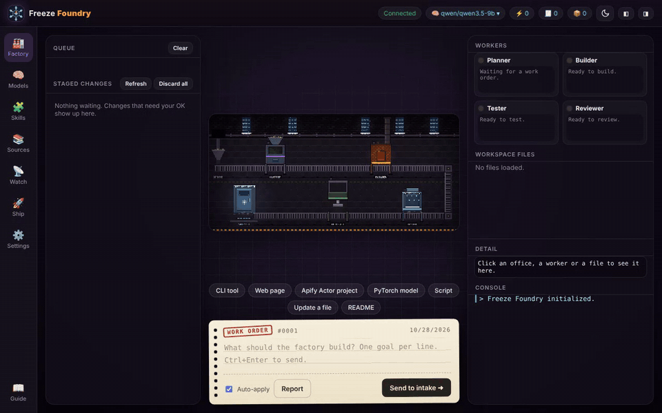

# Freeze Foundry

<p align="center"></p>

<p align="center"><b><a href="https://freezefoundry.com">freezefoundry.com</a></b> · <a href="../../releases/latest">Download</a> · <a href="https://freezefoundry.com/docs">Docs</a> · <a href="CHANGELOG.md">Changelog</a> · <a href="https://github.com/sponsors/AustinAdams11">Sponsor</a></p>

A local-first AI software factory. Type a goal; four workers running on **your own local model** (Planner, Builder, Tester, Reviewer) plan it, write the code, test it and review it, and nothing is written to disk until it passes your approval. All of it plays out on an animated pixel-art factory floor.

Runs on your own local model through [LM Studio](https://lmstudio.ai) or [Ollama](https://ollama.com), or on Claude, OpenAI or Gemini if you add a key.

## Features

- **Four-worker pipeline** with real checks: the Tester runs `node --check`, JSON validation and your workspace's `npm test` in a throwaway copy; the Reviewer judges the diff and test results, and failed work goes back to the Builder with the feedback.
- **Undo, retry and stop**: roll back any applied change, retry failed goals from the Report, stop a run mid-way; unfinished work orders survive a restart. Optional git commit per applied change.
- **Approval gate**: see the diff, then apply or reject. Every applied change keeps a backup.
- **Overnight queue**: one goal per line; with Auto-apply on, changes that pass tests and review are applied and everything else waits in *Staged changes* and the run report.
- **Skills**: reusable instructions in the open Agent Skills format (`skills/<name>/SKILL.md`), switched on by trigger words in a goal and scoped to specific workers. Starter skills included.
- **Models**: pick a model per worker, download `.gguf` models from Hugging Face straight into LM Studio's folder, or pull Ollama models, all from the app.
- **Usage ledger**: tokens and time per worker and task.
- **Local or cloud AI**: LM Studio and Ollama, or Claude, OpenAI, Gemini, OpenRouter and any OpenAI-compatible server. API keys are encrypted with the OS keychain.
- **Sources**: upload reference files or add web pages; workers read them while planning and building.
- **Permissions**: choose whether the AI may read workspace files, run tests, use sources and reach the internet.
- **Training bay (PyTorch)**: the PyTorch blueprint has the workers write a training script; approve it, click **Run** on the `.py` file and watch its output and loss curve live. Off until you allow "Run Python scripts" in Permissions; uses your own Python with torch installed. Works on NVIDIA (CUDA), Apple Silicon (MPS), AMD Radeon (ROCm build of PyTorch, Windows or Linux) and CPU.
- **LAN Foundry**: run workers on other machines' LM Studio or Ollama servers. Plan on your Mac, build on your gaming PC.
- **Worker tuning**: give the Planner, Builder and Reviewer each their own provider, model, temperature, top-p, token limit and standing instructions, e.g. plan with Claude and build on your local GPU.
- **Watch**: poll miners (Antminer/cgminer API on port 4028, Bitaxe/AxeOS), servers or any JSON API on a timer. Chart a value, alert when a rule trips or a device goes offline, POST the alert to a webhook (smart plug, Home Assistant, Discord, ntfy), and optionally have the model explain it.
- **Ship to Apify**: build a complete Apify Actor from a blueprint and publish it to your Apify account in one click.
- **Guide and changelog**: a built-in manual for every page of the app and a What's new log ([CHANGELOG.md](CHANGELOG.md)), with a dot on the Guide button after updates.
- **Light and dark themes**: Frost and Forge, switched from the top bar or set to follow your system.
- **Desktop app** for Windows and macOS, with a first-run setup guide.

## Install

Download the latest installer from the [Releases](../../releases) page:

- **Windows**: `Freeze-Foundry-Setup.exe`. The app isn't code-signed yet, so choose *More info → Run anyway* on the SmartScreen prompt.
- **macOS**: `Freeze-Foundry-arm64.dmg` for Apple Silicon or `Freeze-Foundry-x64.dmg` for Intel. It isn't notarized yet; after dragging it to Applications run
  `xattr -cr "/Applications/Freeze Foundry.app"` once.

Installed copies keep tasks, settings, skills and the workspace in `Documents/Freeze Foundry`.

## Run from source

Requires Node.js 22+.

```bash
npm install
npm run app      # desktop window
npm start        # or: server only, open http://127.0.0.1:4177
npm test
```

Build installers locally with `npm run dist:win` (on Windows) or `npm run dist:mac` (on a Mac). Pushing a tag like `v0.3.0` builds both on GitHub Actions and attaches them to a release.

## How it stays safe

- The server listens on `127.0.0.1` only and rejects requests from other websites.
- Workers can only write inside the workspace folder; path traversal and symlink escapes are rejected.
- Model output is never trusted: changes are tested in a copy, reviewed, and applied only with your approval (or Auto-apply's pass rules).
- Model downloads are limited to Hugging Face `.gguf` links.

## Project layout

```
server.js          API, worker pipeline, file sandbox, skills, downloads
public/index.html  UI and the pixel-art factory floor
app/main.js        Electron desktop shell
starter-skills/    Skills copied into a new install
test/              node:test suite
docs/SPEC.md       Original build specification
```

See [SECURITY.md](SECURITY.md) for the full threat model and how to report a vulnerability.

## License

MIT
